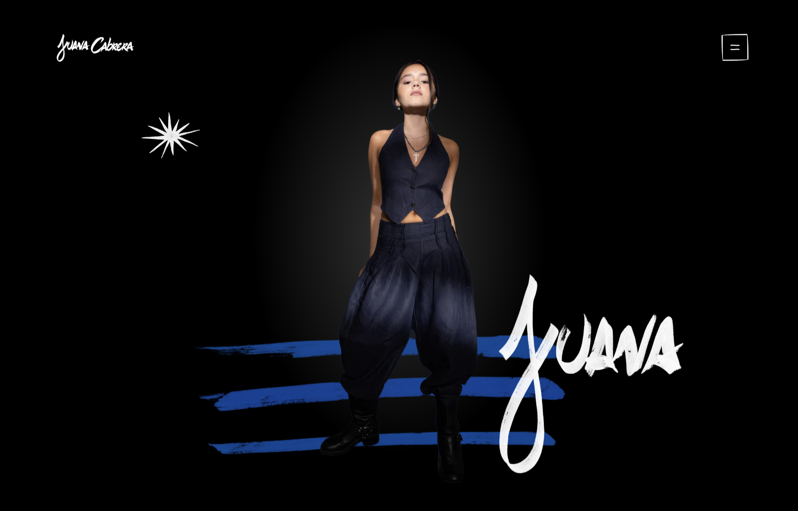

# Juana Cabrera — sitio web

**DEMO:** https://darling-frangollo-d47318.netlify.app



Sitio estático con [Astro](https://astro.build). Una URL por página, responsive con CSS (mobile-first, corte en 768px).

| URL | Archivo | Qué es |
|---|---|---|
| `/` | `src/pages/index.astro` | Home pública, indexable (JSON-LD `Person` + `VideoObject`) |
| `/palabras` | `src/pages/palabras.astro` | `noindex`. Sin sesión muestra la lock screen; con sesión (magic link) la pantalla de escucha |

## Arranque

```sh
npm install
npx playwright install chromium   # una vez
npm run dev          # http://localhost:4321
npm run build        # HTML estático en dist/
npm run check        # typecheck de Astro/TypeScript
npm test             # Playwright (mobile 390 y desktop 1440) sobre el sitio compilado
npm run lighthouse   # Lighthouse mobile sobre la home (requiere build); falla bajo umbral
```

Nota: `astro preview` es un único proceso por proyecto; los tests y Lighthouse reutilizan el que esté corriendo en el puerto 4321 (`astro preview stop` para detenerlo).

## Acceso a `/palabras` (magic link)

1. Lock screen: código + email → `POST /auth/request` al Worker (`worker/`), que manda el mail con Resend.
2. El mail trae `/palabras?token=…` → `POST /auth/verify`; la sesión firmada queda en `localStorage` (`juana.session`) y se limpia el token de la URL.
3. Con sesión vigente `/palabras` abre directo la pantalla desbloqueada (un script inline en `<head>` evita el destello de la lock).

`src/scripts/auth.ts` lee la URL del Worker de `PUBLIC_AUTH_API` (variable de entorno al compilar). Es una barrera de acceso, no protección de los audios (decisión pendiente: issue #3).

## Estructura

- `src/layouts/Base.astro`: SEO, Open Graph, canonical, `noindex`, JSON-LD.
- `src/components/home`, `src/components/palabras`: secciones; `src/styles`: CSS compartido y fuentes autoalojadas.
- `src/scripts`: auth, página de Palabras y reproductor.
- `src/assets`: imágenes optimizadas en build (avif/webp, `srcset`); `public/`: audio, `robots.txt`, imágenes OG.
- `worker/`: Worker de Cloudflare del magic link (`wrangler`).

## Animaciones manuales de Palabras

Excepción autorizada al artifact de diseño: el reproductor de `src/pages/palabras.astro` (pantalla desbloqueada) muestra al caballo corriendo y a las estrellas danzando mediante dibujos distintos cuadro a cuadro. Al reimportar o reimplementar el diseño, conservar las clases `.deco-stars` y `.deco-horse`, el ID `visualStars` (usado por `src/scripts/palabras.ts`), los sprites `src/assets/palabras/caballo-galope-6fps.png` y `src/assets/palabras/estrellas-danza-6fps.png`, los keyframes `deco-frames` y la regla `prefers-reduced-motion` que deja quieto el primer cuadro. Cada sprite transparente mide 1536 × 1024 y contiene seis cuadros de 512 × 512 en una grilla de 3 columnas y 2 filas, en orden de lectura. Se reproduce un ciclo de un segundo con `steps(1,end)`: 6 fps. Los cuadros sólo avanzan mientras hay scroll (página o caja de letras): `src/scripts/palabras.ts` marca `html.is-scrolling` y el CSS pasa `animation-play-state` de `paused` a `running`. Preservar esta animación aunque el artifact tenga figuras estáticas; cambiarla sólo por pedido explícito del usuario. El pedido es animar las poses y formas, no desplazar o rotar el asset estático. Las imágenes originales se conservan para las otras apariciones.

Generación: herramienta integrada `imagegen`, usando los dibujos originales como referencia de estilo. Prompts: seis poses sucesivas de galope hacia la izquierda, con patas que se recogen y extienden y cola articulada; seis poses de cuatro estrellas irregulares que danzan con contornos y conexiones cambiantes. Planchas 3 × 2, escala y centro estables, siluetas negras sin halos sobre transparencia real. El CSS las convierte a blanco y mantiene la opacidad del reproductor.
